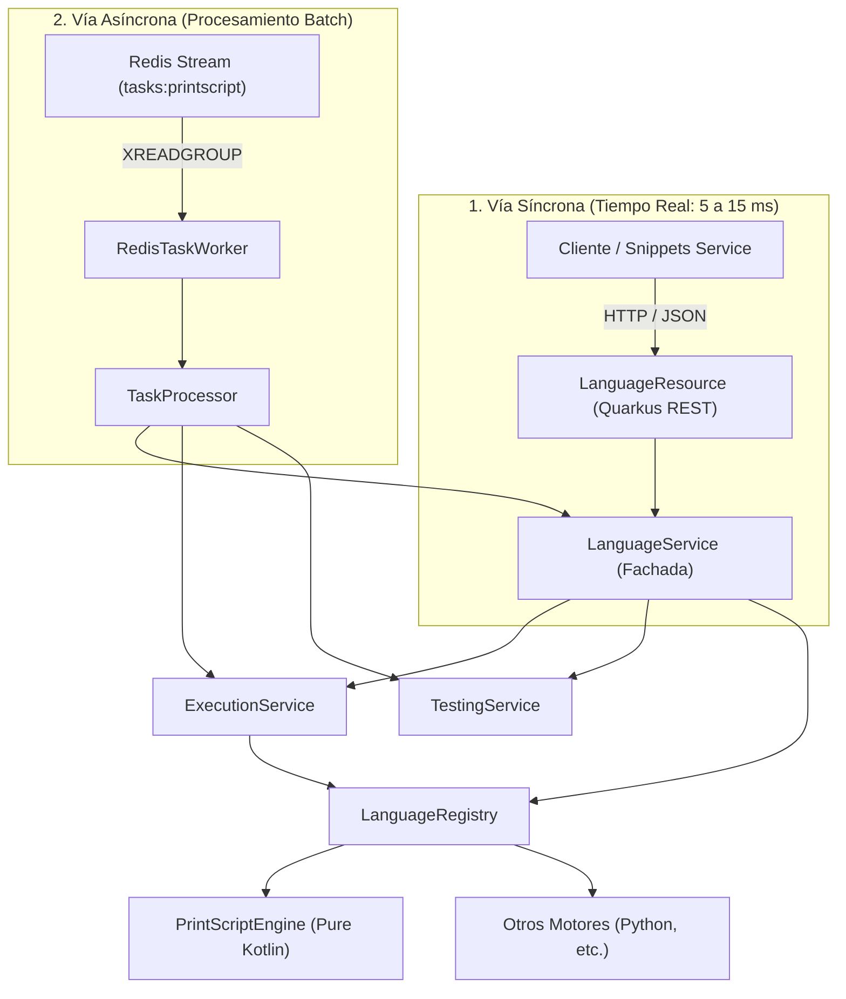

# Language Service

Microservicio computacional para el análisis, ejecución, formateo y testing de snippets de código para múltiples lenguajes (ej: PrintScript, Python, etc.).

Construido sobre **Quarkus 3**, **Kotlin** y **Gradle Kotlin DSL**.

---

## 1. Arquitectura y Filosofía de Diseño

El servicio sigue una arquitectura limpia de capas con doble vía de activación (síncrona para UI interactiva y asíncrona para procesamiento batch con Redis Streams):



### Principios Clave:
* **The Twelve-Factor App (Factores V y VI):** El mismo binario soporta ejecución como API Web (`APP_MODE=web`), Worker de colas (`APP_MODE=worker`) o Híbrido (`APP_MODE=all`), garantizando inmutabilidad y despliegue elástico en Docker Swarm.
* **Inversión de Dependencias (DIP) y Aislamiento:** Los motores de lenguaje son **Kotlin puro**, sin anotaciones ni dependencias de Quarkus. Esto permite correr pruebas unitarias en milisegundos sin levantar el contexto del framework.
* **Segregación de Interfaces (ISP):** Cada lenguaje implementa solo las capacidades que soporta (`validate`, `format`, `lint`, `execute`).
* **Testing como Orquestación (SRP):** El motor no contiene lógica de testing. `TestingService` corre la ejecución a través de `ExecutionService` y evalúa si la salida coincide con el resultado esperado (`expectedOutputs`).
* **Seguridad en Ejecución:** Las ejecuciones cuentan con **timeouts estrictos** y corren fuera del Event Loop reactivo (`@Blocking` / workers dedicados) para prevenir bloqueos por bucles infinitos (`while(true)`).

---

## 2. Estructura de Paquetes (`ingsis.language`)

```text
src/main/kotlin/ingsis/language/
│
├── resources/                 # Capa HTTP (Jakarta REST / Quarkus REST)
│   ├── LanguageResource.kt    # GET /languages, POST validate, format, lint, execute, test
│   ├── ResponseMapper.kt      # Extensiones de mapeo de resultados a HTTP Response
│   └── dtos/                  # Request / Response DTOs inmutables (Jackson)
│
├── services/                  # Casos de uso y orquestación
│   ├── LanguageService.kt     # Fachada orquestadora
│   ├── ExecutionService.kt    # Orquesta ejecución delegando al motor
│   ├── TestingService.kt      # Evalúa aserciones sobre ExecutionService
│   └── LanguageRegistry.kt    # Selector/Factory dinámico de implementaciones de LanguageEngine
│
├── worker/                    # Procesamiento asíncrono (Redis Streams)
│   ├── RedisTaskWorker.kt     # Consumidor con Consumer Groups (XREADGROUP / XACK)
│   ├── TaskProcessor.kt       # Ruteo y procesamiento de tareas hacia los servicios
│   └── events/                # DTOs de eventos (TaskEvent, TaskResultEvent, TaskType)
│
└── domain/                    # Capa de Dominio (Kotlin puro)
    ├── engine/
    │   ├── LanguageEngine.kt  # Contratos base (CodeValidator, CodeFormatter, CodeLinter, CodeExecutor)
    │   └── printscript/       # Adaptador PrintScriptEngine y abstracción PrintScriptRunner
    └── model/
        ├── Diagnostic.kt      # Errores con regla, línea y columna
        ├── DomainError.kt     # Errores sellados del dominio (LanguageNotFound, etc.)
        ├── ExecutionReport.kt # Salidas capturadas, status y tiempo
        ├── LanguageResult.kt  # Result pattern funcional (Success / Failure)
        ├── TestReport.kt      # Resultado de prueba (passed, expectedOutputs, actualOutputs)
        └── ValidationReport.kt# Diagnósticos de sintaxis y linting
```

---

## 3. Endpoints Principales (API Síncrona)

| Método | Endpoint | Descripción |
| :--- | :--- | :--- |
| `GET` | `/languages` | Lista los lenguajes y versiones soportadas |
| `POST` | `/languages/{lang}/validate` | Chequeo sintáctico y semántico (diagnósticos/warnings) |
| `POST` | `/languages/{lang}/format` | Formatea código según reglas de estilo |
| `POST` | `/languages/{lang}/lint` | Valida código según reglas de linting |
| `POST` | `/languages/{lang}/execute` | Ejecuta el código con una lista de inputs y devuelve salidas |
| `POST` | `/languages/{lang}/test` | Ejecuta un caso de prueba y reporta `passed: Boolean` y outputs |

---

## 4. Modos de Ejecución (The Twelve-Factor App)

Configurable mediante la variable de entorno `APP_MODE`:

* `APP_MODE=web`: Activa únicamente los endpoints HTTP (modo interactivo para la UI). El consumidor de Redis permanece inactivo.
* `APP_MODE=worker`: Activa el consumidor de Redis Streams para procesar lotes masivos en segundo plano.
* `APP_MODE=all` (Default): Activa tanto los endpoints HTTP como el consumidor de Redis Streams.

---

## 5. Desarrollo y Comandos Útiles

```bash
# Modo desarrollo con recarga en vivo (Live Reload)
./gradlew quarkusDev

# Ejecutar tests automatizados
./gradlew test

# Generar reporte de cobertura de código (JaCoCo)
./gradlew jacocoTestReport

# Verificar regla de cobertura mínima (0.8 / 80%)
./gradlew jacocoTestCoverageVerification

# Verificar formato y estilo (Ktlint)
./gradlew ktlintCheck

# Auto-formatear código automáticamente (Ktlint)
./gradlew ktlintFormat

# Chequeo completo (ktlint + tests + jacoco - lo mismo que corre en CI)
./gradlew check

# Configurar Git hooks (.githooks/)
./gradlew installGitHooks

# Compilar empaquetado para producción (Fast-JAR)
./gradlew build
```
