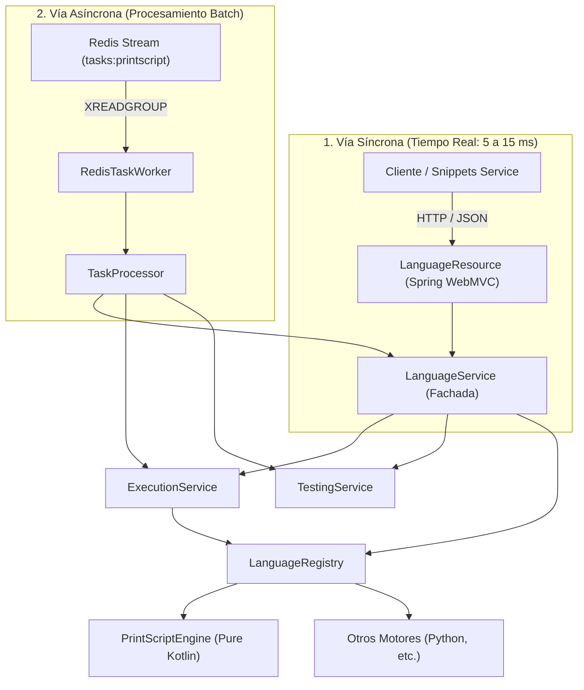

# Language Service

Microservicio computacional para el análisis, ejecución, formateo y testing de snippets de código para múltiples lenguajes (ej: PrintScript, Python, etc.).

Construido sobre **Spring Boot 4**, **Kotlin** y **Gradle Kotlin DSL**.

---

## 1. Arquitectura y Filosofía de Diseño

El servicio sigue una arquitectura limpia de capas con doble vía de activación (síncrona para UI interactiva y asíncrona para procesamiento batch con Redis Streams):



### Principios Clave:
* **The Twelve-Factor App (Factores V y VI):** El mismo binario soporta ejecución como API Web (`APP_MODE=web`), Worker de colas (`APP_MODE=worker`) o Híbrido (`APP_MODE=all`), garantizando inmutabilidad y despliegue elástico en Docker Swarm.
* **Inversión de Dependencias (DIP) y Aislamiento:** Los motores de lenguaje son **Kotlin puro**, sin anotaciones ni dependencias de Spring. El ensamblado de beans vive en `config/EngineConfig.kt`, permitiendo correr pruebas unitarias en milisegundos sin levantar el contexto del framework.
* **Segregación de Interfaces (ISP):** Cada lenguaje implementa solo las capacidades que soporta (`validate`, `format`, `lint`, `execute`).
* **Testing como Orquestación (SRP):** El motor no contiene lógica de testing. `TestingService` corre la ejecución a través de `ExecutionService` y evalúa si la salida coincide con el resultado esperado (`expectedOutputs`).
* **Seguridad en Ejecución:** Las ejecuciones cuentan con **timeouts estrictos** y workers dedicados para prevenir bloqueos por bucles infinitos (`while(true)`).

---

## 2. Estructura de Paquetes (`ingsis.language`)

```text
src/main/kotlin/ingsis/language/
│
├── LanguageApplication.kt     # Entrypoint Spring Boot
│
├── config/                    # Configuración e inyección de dependencias
│   └── EngineConfig.kt        # Registro de motores de dominio puro como beans
│
├── resources/                 # Capa HTTP (Spring WebMVC)
│   ├── LanguageResource.kt    # GET /languages, POST validate, format, lint, execute, test
│   ├── GlobalExceptionHandler.kt # Manejo uniforme de errores JSON malformados
│   ├── ResponseMapper.kt      # Extensiones de mapeo de resultados a ResponseEntity
│   └── dtos/                  # Request / Response DTOs inmutables (Jackson 3)
│
├── services/                  # Casos de uso y orquestación
│   ├── LanguageService.kt     # Fachada orquestadora
│   ├── ExecutionService.kt    # Orquesta ejecución delegando al motor
│   ├── TestingService.kt      # Evalúa aserciones sobre ExecutionService
│   └── LanguageRegistry.kt    # Selector dinámico de implementaciones de LanguageEngine
│
├── worker/                    # Procesamiento asíncrono (Redis Streams)
│   ├── RedisTaskWorker.kt     # Consumidor SmartLifecycle con Consumer Groups (XREADGROUP / XACK)
│   ├── TaskProcessor.kt       # Ruteo y procesamiento de tareas hacia los servicios
│   └── events/                # DTOs de eventos (TaskEvent, TaskResultEvent, TaskType)
│
└── domain/                    # Capa de Dominio (Kotlin puro)
    ├── engine/
    │   ├── LanguageEngine.kt  # Contratos base (CodeValidator, CodeFormatter, CodeLinter, CodeExecutor)
    │   └── printscript/       # Adaptador PrintScriptEngine y abstracción PrintScriptRunner
    └── model/
        ├── Diagnostic.kt      # Errores con regla, línea y columna
        ├── DomainError.kt     # Errores sellados del dominio (LanguageNotFound, etc.)
        ├── ExecutionReport.kt # Salidas capturadas, status y tiempo
        ├── LanguageResult.kt  # Result pattern funcional (Success / Failure)
        ├── TestReport.kt      # Resultado de prueba (passed, expectedOutputs, actualOutputs)
        └── ValidationReport.kt# Diagnósticos de sintaxis y linting
```

---

## 3. Endpoints Principales (API Síncrona)

| Método | Endpoint | Descripción |
| :--- | :--- | :--- |
| `GET` | `/languages` | Lista los lenguajes y versiones soportadas |
| `POST` | `/languages/{lang}/validate` | Chequeo sintáctico y semántico (diagnósticos/warnings) |
| `POST` | `/languages/{lang}/format` | Formatea código según reglas de estilo |
| `POST` | `/languages/{lang}/lint` | Valida código según reglas de linting |
| `POST` | `/languages/{lang}/execute` | Ejecuta el código con una lista de inputs y devuelve salidas |
| `POST` | `/languages/{lang}/test` | Ejecuta un caso de prueba y reporta `passed: Boolean` y outputs |

---

## 4. Modos de Ejecución (The Twelve-Factor App)

Configurable mediante la variable de entorno `APP_MODE`:

* `APP_MODE=web`: Activa únicamente los endpoints HTTP (modo interactivo para la UI). El consumidor de Redis permanece inactivo.
* `APP_MODE=worker`: Activa el consumidor de Redis Streams para procesar lotes masivos en segundo plano.
* `APP_MODE=all` (Default): Activa tanto los endpoints HTTP como el consumidor de Redis Streams.

---

## 4.1 Motor PrintScript (CNC)

`CncPrintScriptRunner` usa el motor CNC (`com.github.TP1-2-INGSIS:printscript`, GitHub Packages) para validate / lint / format / execute / test de PrintScript 1.0 y 1.1. La versión del motor sale de `cncVersion` en `gradle.properties` (única fuente de verdad) y se publica como `engineVersion` en cada elemento de `GET /languages`.

* **Credenciales:** el build lee `GITHUB_ACTOR` + `GPR_TOKEN` (o `GITHUB_TOKEN`), o las propiedades `gpr.user` / `gpr.key`. En CI hace falta `permissions: packages: read` y que el paquete de CNC esté compartido con este repo (o un secret `GPR_TOKEN` con `read:packages`). En Docker se pasan como BuildKit secrets `gpr_user` y `gpr_token`.
* **Build local sin token:** desde un checkout de CNC en el tag correspondiente, `./gradlew publishToMavenLocal -PreleaseVersion=<cncVersion>`, y luego `./gradlew -PuseMavenLocal=true check`.
* **Diagnósticos:** `{rule, message, line, column}` con línea y columna desde 1. CNC no informa posición en errores semánticos ni de runtime: en ese caso es `1:1`. `rule` es `lexer`, `parser`, `semantic`, `runtime`, `syntax` (lint sobre código inválido) o la key de la regla de lint violada.
* **Ejecución:** los `inputs` se consumen en orden para `readInput` (si faltan, la ejecución termina con un diagnóstico `runtime`); los `println` se devuelven en `outputs`; el prompt de `readInput` no se incluye en `outputs`. `readEnv` lee de un mapa opcional (vacío por defecto), nunca del entorno del servidor. `PrintScriptRunner.run` recibe un `ExecutionIO` (lambdas) para reutilizarlo en ejecución interactiva.

### Keys de reglas aceptadas

Las keys desconocidas se ignoran; si `rules` no es un objeto JSON, responde 400 `INVALID_RULES`.

| Operación | Key | Tipo |
|---|---|---|
| lint | `identifierFormat` (alias `identifier_format`) | string: `"camel case"` o `"snake case"` |
| lint | `mandatory-variable-or-literal-in-println` | boolean |
| lint | `mandatory-variable-or-literal-in-readInput` | boolean |
| format | `enforce-spacing-before-colon-in-declaration` | boolean (`true` activa la regla; `false` no hace nada) |
| format | `enforce-spacing-after-colon-in-declaration` | boolean |
| format | `enforce-spacing-around-equals` | boolean |
| format | `enforce-no-spacing-around-equals` | boolean |
| format | `mandatory-single-space-separation` | boolean |
| format | `mandatory-space-surrounding-operations` | boolean |
| format | `mandatory-line-break-after-statement` | boolean |
| format | `line-breaks-after-println` | integer |
| format | `indent-inside-braces` (alias `indent-inside-if`) | integer |
| format | `if-brace-below-line` (1.1) | boolean |
| format | `if-brace-same-line` (1.1) | boolean |

CNC aplica una sola regla "de estructura" por llamada; Language las ejecuta en pasadas sucesivas (espaciado + `line-breaks-after-println`, salto por sentencia, llave del if, indentación) para que se puedan combinar.

---

## 5. Desarrollo y Comandos Útiles

```bash
# Ejecutar aplicación en modo desarrollo
./gradlew bootRun

# Ejecutar tests automatizados
./gradlew test

# Generar reporte de cobertura de código (JaCoCo)
./gradlew jacocoTestReport

# Verificar regla de cobertura mínima (0.8 / 80%)
./gradlew jacocoTestCoverageVerification

# Verificar formato y estilo (Ktlint)
./gradlew ktlintCheck

# Auto-formatear código automáticamente (Ktlint)
./gradlew ktlintFormat

# Chequeo completo (ktlint + tests + jacoco - lo mismo que corre en CI)
./gradlew check

# Configurar Git hooks (.githooks/)
./gradlew installGitHooks

# Compilar empaquetado ejecutable para producción (Boot JAR)
./gradlew bootJar
```
