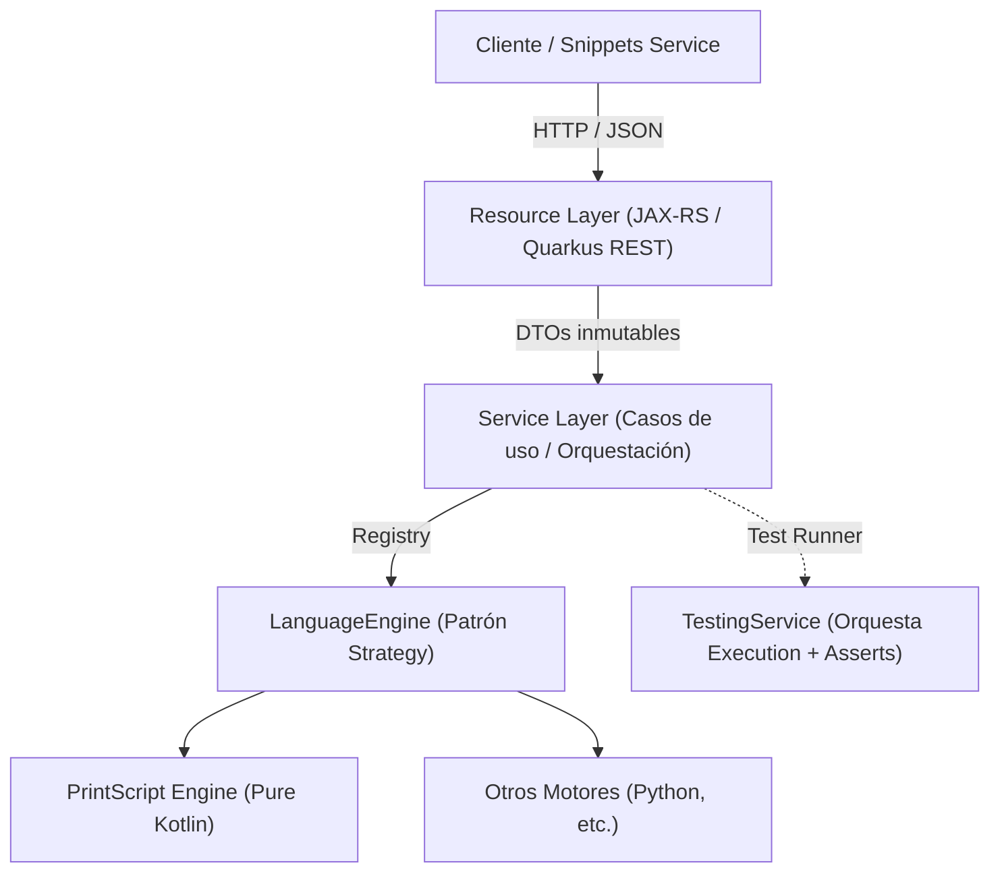

# Language Service

Microservicio computacional para el análisis, ejecución, formateo y testing de snippets de código para múltiples lenguajes (ej: PrintScript, Python, etc.).

Construido sobre **Quarkus 3**, **Kotlin** y **Gradle Kotlin DSL**.

---

## 1. Arquitectura y Filosofía de Diseño

El servicio sigue una arquitectura limpia de 3 capas con estricto desacoplamiento entre el framework web y los motores de ejecución:



### Principios Clave:
* **Inversión de Dependencias (DIP) y Aislamiento:** Los motores de lenguaje son **Kotlin puro**, sin anotaciones ni dependencias de Quarkus. Esto permite correr pruebas unitarias en milisegundos sin levantar el contexto del framework.
* **Segregación de Interfaces (ISP):** Cada lenguaje implementa solo las capacidades que soporta (`validate`, `format`, `execute`).
* **Testing como Orquestación (SRP):** El motor no contiene lógica de testing. `TestingService` corre la ejecución con una lista de inputs y evalúa si la salida coincide con el resultado esperado (`expectedOutputs`).
* **Seguridad en Ejecución:** Las ejecuciones cuentan con **timeouts estrictos** y corren fuera del Event Loop reactivo (`@Blocking` / workers dedicados) para prevenir bloqueos por bucles infinitos (`while(true)`).

---

## 2. Estructura de Paquetes (`ingsis.language`)

```text
src/main/kotlin/ingsis/language/
│
├── resource/                  # Capa HTTP (Jakarta REST / Quarkus REST)
│   ├── LanguageResource.kt    # GET /languages (metadatos y versiones soportadas)
│   ├── ExecutionResource.kt   # POST /languages/execute y POST /languages/test
│   ├── FormattingResource.kt  # POST /languages/format
│   ├── ValidationResource.kt  # POST /languages/validate
│   └── dto/                   # Request / Response DTOs inmutables (Jackson)
│
├── service/                   # Casos de uso y orquestación
│   ├── ExecutionService.kt    # Orquesta ejecución con timeout y captura de salidas
│   ├── TestingService.kt      # Evalúa casos de prueba sobre ExecutionService
│   ├── FormattingService.kt   # Aplica reglas de formato
│   └── LanguageRegistry.kt    # Selector/Factory de implementaciones de LanguageEngine
│
└── domain/                    # Capa de Dominio (Kotlin puro)
    ├── engine/
    │   └── LanguageEngine.kt  # Contrato base de capacidades
    └── model/
        ├── TestCase.kt        # Modelo de caso de prueba (inputs, expectedOutputs)
        ├── ExecutionReport.kt # Salidas capturadas, status y tiempo
        └── ValidationReport.kt# Diagnósticos de sintaxis y linting
```

---

## 3. Endpoints Principales

| Método | Endpoint | Descripción |
| :--- | :--- | :--- |
| `GET` | `/languages` | Lista los lenguajes y versiones soportadas |
| `POST` | `/languages/validate` | Chequeo sintáctico y semántico (diagnósticos/warnings) |
| `POST` | `/languages/format` | Formatea código según reglas de estilo |
| `POST` | `/languages/execute` | Ejecuta el código con una lista de inputs y devuelve salidas |
| `POST` | `/languages/test` | Ejecuta casos de prueba y reporta resultados (`PASSED`, `FAILED`, `DIFF`) |

---

## 4. Desarrollo y Comandos Útiles

```bash
# Modo desarrollo con recarga en vivo (Live Reload)
./gradlew quarkusDev

# Ejecutar tests automatizados
./gradlew test

# Compilar empaquetado para producción (Fast-JAR)
./gradlew build
```
